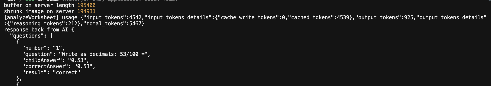
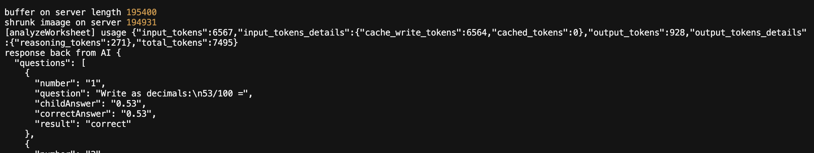

# Fawna — Engineering Decisions

Status: **Proposed** (agreed, not built) · **Accepted** (being built) · **Implemented** (in code) · **Validated** (proven by tests or real use)

---

# ADR-001: Check uploads in both browser and server

- Date: 2026-09-11
- Status: Implemented

**Context:** Parents need quick feedback on bad files. The server must never process one.

**Options:** Browser only · Server only · Both

**Decision:** Both, with the same rules (PNG/JPEG/WebP, same size limit). The browser gives instant feedback. The server is the real safety check, because anyone can call `/api/analyze` directly. It replies 400 (no file), 413 (too big) or 415 (wrong type).

**Risks:** The rules are written twice and could drift apart. The file type is whatever the browser reports, not checked from the file's contents.

**Validation:** Tested by hand. No automated tests.

**Lesson:** Browser checks are for convenience. Server checks are for safety.

---

# ADR-002: Send the photo to the AI as base64

- Date: 2026-10-20
- Status: Validated

**Context:** The AI needs to see the photo. These are photos of children's work, so privacy matters.

**Options:** Base64 in the request · Store it online and send a link · Upload to OpenAI first and refer to it by ID

**Decision:** Base64. It's the simplest, and the photo is never stored. A link means storing children's work. An upload ID only helps if the same photo is analysed many times.

**Risks:** About 33% bigger than the original. The whole photo is held in server memory.

**Validation:** A real worksheet photo went through OpenAI and every question was read (2026-10-24).

**Lesson:** Base64 rewrites the same bytes as text. Nothing is removed, including hidden photo data.

---

# ADR-003: Shrink photos in the browser before upload

- Date: 2026-10-20
- Status: Validated

**Context:** Phone photos are large. The AI shrinks large images anyway and is charged by pixel size, so most of the upload is wasted, which is slow on mobile.

**Options:** Upload the original · Shrink on the server · Shrink in the browser

**Decision:** Shrink in the browser to 1600 px on the long side, JPEG at 80% quality (`lib/image/shrinkImage.ts`). Only shrinking in the browser speeds up the parent's upload.

**Risks:** Small text could become unreadable.

**Validation:** A real iPhone photo went from 4.2 MB to 260 KB and stayed upright (`docs/process.md`). The AI still read every question on golden-set entry 1.

**Lesson:** Pixel size matters to the AI more than file size.

---

# ADR-004: Remove hidden photo data in the browser and on the server

- Date: 2026-10-20 (updated 2026-10-24)
- Status: Validated

**Context:** Phone photos carry hidden data (EXIF) that can include the home's location.

**Options:** Browser only · Server only · Both

**Decision:** Both. Shrinking in the browser removes it for free. The server shrinks again with sharp as a safety net, in case the browser step was skipped (an old cached page, or someone calling the endpoint directly).

**Risks:** sharp is an extra dependency on the server.

**Validation:** After the server step, the hidden data sections were gone from the file (`docs/process.md`).

**Lesson:** Logging in answers "who sent this?", not "was this file processed?"

---

# ADR-005: Two AI calls: Review, then Practice

- Date: 2026-10-21
- Status: Proposed (Review is built, Practice is not)

**Context:** Parents want marks first. Only some will want practice.

**Options:** One big call that does everything · Two calls

**Decision:** Two calls.

1. **Review** (on Analyze): reads the photo, marks each question and names the skill for each wrong or blank answer.
2. **Practice** (one "Practice my mistakes" button): makes questions **grouped by skill**, not by question, at easier, same or harder levels. It's sent text only, never the photo.

**Why:** You only pay for practice when it's asked for. Marks show up faster. The child's handwriting is sent once. Each step can be tested on its own.

**Lesson:** Split work where the user's choices split.

---

# ADR-006: Skill names come from a fixed list

- Date: 2026-10-21
- Status: Implemented (`lib/ai/mathSkills.ts`)

**Context:** If the AI makes up skill names, the same gap gets different names ("carrying" or "regrouping"). Then results can't be grouped or tracked over time.

**Options:** The AI makes up names · A fixed list the AI must pick from

**Decision:** Two levels, **category → skill**, based on the National Curriculum for England (Years 1–6). The AI can only pick from the list. If nothing fits, it **suggests** a new skill (category and name), which we review and may add.

- `id` never changes. `name` can be reworded.
- `fromYear` will let us show the AI only the skills up to the child's year.
- Each skill has one `kind` (see ADR-013).

**Risks:** The list may miss skills. The curriculum changes in September 2028.

**Lesson:** Short names don't stop duplicates. A fixed list does.

---

# ADR-007: The AI marks the answers, and code counts them

- Date: 2026-10-22
- Status: Implemented (10/10 on 1 real worksheet, `docs/golden-set.md`)

**Context:** Code can check `36 + 47`, but not word problems, graphs or shapes.

**Options:** Code checks the maths · The AI marks everything

**Decision:** The AI marks. To make it more reliable:

- It writes `correctAnswer` **before** `result`, so it solves before it judges.
- It can say **"unreadable"** instead of guessing.
- **Every wrong answer is a skill gap**, even a one-off slip.
- **Code**, not the AI, adds up the totals (`route.ts`).

**Risks:** The AI can get simple sums wrong.

**Revisit when:** Tests show maths mistakes. Then add a code double-check for plain sums only.

**Lesson:** The order of fields in the schema changes the quality of the answer.

---

# ADR-008: The AI replies in a fixed shape

- Date: 2026-10-21
- Status: Implemented (`lib/ai/worksheetSchema.ts`)

**Context:** The page needs reliable data, not a chatty reply.

**Options:** Ask for JSON in the instructions · Make OpenAI enforce a schema

**Decision:** Enforce it. Use OpenAI Structured Outputs (`text.format`) with a **Zod** schema. Zod also checks the reply while the app runs, which TypeScript types can't do. The TypeScript types come from the schema (`z.infer`), so the shape is written once.

**Risks:** The schema is sent with every call, which adds to the cost.

**Lesson:** Asking for a format is a request. A schema is a rule.

---

# ADR-009: Send the AI only the photo and the school year

- Date: 2026-10-21
- Status: Implemented (year is fixed at 5 for now)

**Context:** The year sets the skill list, the practice level and the tone. Families will enter the child's name and year when they sign up.

**Decision:**

- `analyzeWorksheet` takes the year as an input. For now the route passes a fixed value. Later it will come from the family account. The function won't change.
- **The child's name is never sent to the AI.** Use it only on our own page.
- Parents don't choose what the AI does. Analyze always does the same job.

**Lesson:** Only send an outside service what it needs. A function shouldn't care where its inputs come from.

---

# ADR-010: How we call OpenAI

- Date: 2026-10-22
- Status: Implemented

**Decision:**

- Use the **Responses API** (`responses.parse`), not the older `chat.completions`.
- **`instructions`** holds the fixed marking rules. They're written once in `analyzeWorksheet.ts`, not passed in from the route. They're sent with every call, because the API has no memory, and kept the same each time so OpenAI's caching makes them cheaper.
- **`input`** holds what changes: the year and the photo (data URL, `detail: "high"`).

**Lesson:** Instructions are the function. The input is its arguments.

---

# ADR-011: Choose the model by testing

- Date: 2026-10-22
- Status: Accepted (`gpt-6.1-sol`, based on 1 worksheet)

**Context:** Reading handwriting is the hard part. A misread "7" marks a right answer as wrong.

**Options:** `gpt-6-luna` (cheapest) · `gpt-6.1-sol` (mid) · `gpt-6-astra` (most capable)

**Decision:** Mark a real worksheet by hand. Run it through Luna and Sol. Pick the cheapest one that marks everything correctly.

**Validation:** Golden-set entry 1 (`docs/golden-set.md`): Luna marked 9/10 (it got its own answer to Q8 wrong). Sol marked 10/10. Both named 0 of 2 skills the way we would (ADR-017 later got Sol to 2/2). Only one worksheet so far. Cost is still estimated, not measured: about $0.001 (Luna) to $0.02 (Sol) per worksheet.

**Revisit when:** the instructions improve. Then try Luna again, since it's about 20× cheaper.

**Lesson:** Accuracy matters more than model cost at this scale.

---

# ADR-012: Four result shapes, and a skill is required where it matters

- Date: 2026-10-24
- Status: Implemented (`lib/ai/worksheetSchema.ts`)

**Context:** Each question needs a result. Wrong answers must always name a skill. Some answers can't be read, and some are left blank. Two true/false fields (`isCorrect`, `isReadable`) would allow nonsense like "unreadable but correct".

**Options:** Two true/false fields · One `result` field with an optional skill · A different shape for each result (`discriminatedUnion`)

**Decision:** A different shape for each result. `result` says which one:

| Result | Skill? |
|---|---|
| `correct` | No |
| `incorrect` | **Required:** the skill for the step that went wrong |
| `unreadable` | No. The AI must not guess. |
| `blank` | **Required:** the main skill the question tests, so it can go into practice. If every answer is crossed out, it counts as blank. |

A skill is either **from the list** (`skillId`) or **suggested** (category and a short name).

**In my words:** I used `discriminatedUnion` so every answer marked "incorrect" must include a skill from our approved list, or a suggested one if none fits. This prevents missing skills and made-up skill names, and keeps skill gap naming consistent.

**Trade-offs and risks:**

- The schema makes sure the skill is **from the list**, not that it's the **right** one.
- We don't know why a question was left blank (didn't know how, or ran out of time).

**Validation:** Tested locally with Zod: a good reply passes. These are rejected: "incorrect" with no skill, a made-up skill id, and "blank" with no skill. OpenAI accepts the format (strict mode). Real AI replies on golden-set entry 1 passed the schema.

**Lesson:** Make impossible states impossible.

---

# ADR-013: Each skill has one kind: fact, method or idea

- Date: 2026-10-24
- Status: Implemented in the list (`lib/ai/mathSkills.ts`). Not used for help yet.

**Context:** Not every mistake needs an explanation. Getting 7 × 5 or 1 kg = 1000 g wrong just means the fact isn't memorised yet. But one skill can hide two kinds: "Converting units" can be a forgotten fact (1 kg = 100 g) or a broken method (2.5 kg = 25 g).

**Options:** The AI decides the kind for each mistake · Keep the kind on each skill as it was · Split mixed skills so each skill has exactly one kind

**Decision:** Split them. The kind is fixed in our list, decided once, by a person. The AI only picks the most specific skill, "for the exact step that went wrong".

- **fact:** remember one thing → recall practice
- **method:** follow steps → worked example
- **idea:** understand why → a picture first

Test: *"Could a child get this right just by remembering one thing?"* Yes means fact.

**Trade-offs and risks:**

- Some kinds are judgement calls (BIDMAS = fact, telling the time = method). They need review.
- The AI may still pick the topic instead of the step that broke.

**Validation:** 116 skills, each with one kind, no duplicate ids. Golden set started with 1 worksheet (`docs/golden-set.md`). Goal: 15–20 real mistakes.

**Lesson:** Put decisions in data you control, not in the AI's judgement.

---

# ADR-014: Layered error handling

- Date: 2026-10-24
- Status: Implemented (`app/api/analyze/route.ts`)

**Context:** One `catch` sent every failure as 400 "Malfunctioning in the system". The parent couldn't tell "try another photo" from "try again later", and 400 wrongly blamed them. Also, `catch (Error)` hid JavaScript's built-in `Error`.

**Options:** One catch for everything · Each helper catches and returns a response · Helpers throw, the route decides

**Decision:** Helpers throw. The route decides what the parent sees.

- **Layer 1, the image:** sharp fails → **422** "We couldn't open this photo."
- **Layer 2, the AI:** busy → **503**, too slow → **504**, anything else → **502**.
- The real error is logged with `console.error`. The parent only sees a simple message, never `error.message`.
- The OpenAI client gives up after 60 seconds and retries once.

I first added a `try/catch` inside `analyzeWorksheet` that returned a response. We removed it, because it hid the error type from the route, so "busy" and "too slow" could never be shown.

**Trade-offs and risks:**

- 502 covers many causes (bad key, empty reply, a bug). The logs tell them apart.
- The page doesn't use the status codes yet.

**Validation:** TypeScript passes. A wrong API key gave the parent a 502 with a simple message, while the full error showed in the server logs. The other error paths haven't been triggered yet.

**Lesson:** Catch errors only where you can do something about them.

---

# ADR-015: Understand the mistake before practising it

- Date: 2026-10-24
- Status: Proposed (not built, waits until marking is accurate)

**Context:** Parents want the score. But giving more questions of the same type doesn't fix a misunderstanding. The child just practises the mistake.

**Options:** Score, then practice · Score, explanation, an "Understood" button, then practice · Score, explanation, a check question, then practice

**Decision:** Five steps:

1. **Result:** the parent sees the score, what went well, and a short "how to help" note.
2. **Understand:** the child's answer next to the right one, step by step. Fact gaps skip this (ADR-013).
3. **Check:** one question. If it's right, go on. If it's wrong, explain another way. 2 tries at most, then suggest asking the teacher.
4. **Practice:** questions of the same type first, then mixed with other skills.
5. **Later:** bring the skill back a few days later (needs accounts).

A check question replaces the "Understood" button, because children (and adults) are poor judges of whether they've understood.

**Evidence (research, not our tests):** Comparing wrong and right examples builds understanding (Booth et al., 2013). Mixed practice scored 61% vs 38% a month later (Rohrer et al., 2019). Children of maths-anxious parents learned less when those parents often helped with homework (Maloney et al., 2015).

**Trade-offs and risks:** More AI calls, so more cost. More to build. The check question itself could be marked wrongly.

**Validation:** None yet.

**Lesson:** Feeling you understand isn't the same as understanding.

---

# ADR-016: `useWhen` hints for skills that look alike

- Date: 2026-10-24
- Status: Implemented in `lib/ai/mathSkills.ts`, and sent to the AI since ADR-017.

**Context:** On golden-set entry 1, Sol named 0 of 2 skills the way we would. It picked the topic (`fractions-to-decimals`, `fraction-decimal-percent`) instead of the step that broke. Some skills look alike, and the AI only sees their ids.

**Options:** Rename skills so they never overlap · Remove the broad topic skills · Add a short hint to skills that overlap

**Decision:** Add an optional `useWhen` hint, only to skills that overlap. It says when to pick that skill. Start with two:

| Skill | Pick it when |
|---|---|
| `percentage-facts` | The digits are different from the right answer (25% → 0.4). The child doesn't know the fact. |
| `dividing-by-10-100-1000` | The digits are the same, but the point is in the wrong place (0.66 for 0.066, 2.5 for 0.25). |
| `fraction-means-division` (new, idea) | The child writes the fraction's own numbers after the point (3/4 → 0.34). Memorising 3/4 = 0.75 won't fix this: they'd still write 2/5 → 0.25. |

`fraction-means-division` starts at Year 4, not Year 6 where the curriculum names it, because the mistake shows up as soon as children start decimals.

**Why:** A wrong answer is a clue. Same digits in the wrong place means a ÷10/100/1000 slip. New digits mean a missing fact. The hint is optional, so the other skills don't change.

**Trade-offs and risks:**

- Each hint adds text to every call, which costs a little more.
- Two hints written for one worksheet could fit that worksheet too closely. More worksheets will test them.

**Validation:** TypeScript passes. With the hints sent (ADR-017), Sol picked both skills right on golden-set entry 1.

**Lesson:** If two choices look alike, say how to tell them apart.

---

# ADR-017: Send the skill list (names, kinds, hints) in the instructions

- Date: 2026-10-25
- Status: Implemented (`lib/ai/analyzeWorksheet.ts`). Tested on 1 worksheet.

**Context:** The AI only saw skill **ids**, through the schema (`z.enum(SKILL_IDS)`). Names, kinds and `useWhen` hints lived in `mathSkills.ts`, but nothing sent them. So the AI guessed what each id meant from its spelling. `fractions-to-decimals` looks like the topic of "3/250 as a decimal", so it picked that. This explains the 0/2 skill score on entry 1.

The schema says **which answers are allowed**. It doesn't say **what they mean**.

**Options:**

| Option | Good | Bad |
|---|---|---|
| Keep ids only | Cheapest | The AI guesses meanings. This is how we got 0/2. |
| Put the list in each skill's schema description | Next to the id | A schema enum can't describe each value well. Harder to read. |
| Put the list in the **input**, next to the photo | Easy to change per child | Changes position on each call, so it's less likely to be cached |
| Put the list in the **instructions** | Same text every call, so OpenAI caches it and charges less. Kept in one place. | Sent on every call (about 2,000 tokens) |

**Decision:** Instructions. Code builds one line per skill from `MATH_CATEGORIES` (id, name, kind, hint if there is one) and adds it to `MARKING_INSTRUCTIONS`. The list is never written out by hand, so it can't drift from `mathSkills.ts`. We log `response.usage` to see the real token cost.

**Why this matters for the product:** The skill list, kinds and hints are our own teaching decisions. A general chatbot doesn't have them. Sending them is what turns "an AI that marks" into Fawna.

**Trade-offs and risks:**

- More tokens per call. Caching makes most of them cheaper after the first call.
- A longer list could distract the AI. Later we can send only skills up to the child's year (`fromYear`).
- If hints are badly written, the AI will follow them anyway. They need testing like code.

**How I tested it:** I wanted to know two things: does the full list help the AI pick the right skill, and how much more does it cost?

I added one line that logs `response.usage` after each call (tokens in, out and cached). Then I ran golden-set entry 1 through `gpt-6.1-sol` before and after the change. Same photo, same model, one change, so any difference comes from the skill list.

| | Before (ids only) | After | After, run again |
|---|---|---|---|
| Tokens in | 4,542 (4,539 cached) | 6,567 (0 cached) | 6,567 (6,564 cached) |
| Tokens out | 925 | 928 | 876 |
| Marking | 10/10 | 10/10, but 4a/4b and 5a/5b joined into one row each | 10/10 |
| Q2 skill | `fractions-to-decimals` ❌ | `dividing-by-10-100-1000` ✅ | same ✅ |
| Q8 skill | `fraction-decimal-percent` ❌ | `percentage-facts` ✅ | same ✅ |
| **Skills** | **0/2** | **2/2** | **2/2** |
| Time | 11.2 s | ~12 s | 11.6 s |

**What this shows:**

- Telling the AI what each skill means fixed both picks, and it held on a second run.
- The list costs about 2,000 extra tokens in (+45%). Tokens out stay the same.
- Caching works. The first "after" run had 0 cached because the instructions changed. The next run had almost all of it cached.

**What it doesn't show yet:**

- I sent the same photo every time, so caching looks better than it will be. With a new photo, only the instructions and schema get cached.
- It's one worksheet, and the hints were written for it. New worksheets are the real test.
- The AI sometimes joins 4a/4b into one row. Here both were right, but a wrong 4b would be hidden. It's probably not the skill list, since it changes between runs. Keep an eye on it.

**Validation:** 0/2 → 2/2 skills on golden-set entry 1, held over two runs. Not yet tested on a new worksheet.

**Lesson:** An allowed list isn't the same as an explained list. If the AI has to choose, tell it what each choice means.

---

# ADR-018: Hero colours come from the painting, not a brand green

- Date: 2026-10-27
- Status: Implemented on the landing page.

**Context:** The first hero had a dark green layer over the kitchen picture, ivory text and ivory buttons, and a white band below. It looked like a banner stuck on a photo. The picture is warm all over (plaster wall, terracotta floor, walnut table, amber lamp, plum sky), and the left third is an empty wall.

**Options:** Keep green and tune it · No layer, dark text on the bare wall · A dusk-plum layer · An espresso layer (the table's shadow)

**Decision:** An espresso layer, cream text, and one cream button with espresso text. Every colour is taken from the picture. The hero fills the first screen. Headings change from Oswald to Fraunces, a soft serif. On phones the text moves to the bottom over a shadow, so the family stays in view.

| Token | Value | Used for |
|---|---|---|
| `cream` | `#f5e7d2` | hero text, main button |
| `linen` | `#fbf3e6` | button hover, section backgrounds |
| `espresso` | `#26160e` | dark layer, button text and shadow |
| `ink` | `#33211a` | body text on light pages |

**Why:** Green is cool and the picture is warm, so the green looked stuck on top. Brown is already in the scene, so the layer looks like evening light. With only one bright button, you see the family first.

**Trade-offs and risks:**

- The dialog in `ExamplePreview` still uses the old `ivory` and `forest` colours. They stay in `globals.css` until I restyle it.
- Cream text on the wall works for big headings. Body text must stay short.
- I tried lamp amber (`#e9a43f`) and terracotta for one word in the headline. Cream alone was calmer.

**Validation:** TypeScript and lint pass. Checked in the browser on desktop and phone.

**Lesson:** When a page has a strong picture, take the colours from it. The brand colour can follow.

---

# ADR-019: Plain Three.js for the PRACTICE block letters

- Date: 2026-10-28
- Status: Implemented in `app/components/landing/blockLetters/`.

**Context:** After the hero, the word PRACTICE shows as 3D block letters that rock gently, like Relume's PUBLISH. The letters must be real 3D shapes, not image frames.

**Options:** CSS 3D (no library, but about 350 elements) · Plain Three.js (one scene, two draw calls) · React Three Fiber (adds a React layer on top of Three)

**Decision:** Plain Three.js. It only loads (with `next/dynamic`) when the section is close to the screen. Each filled grid square is a cube. All cubes are merged into one mesh, with one set of outlines. Flat (orthographic) camera, see-through canvas, turning ±20° over 11 s. A flat SVG of the word shows first. It stays for users who prefer reduced motion or don't have WebGL.

**Why:** The design needed a flat camera and a WebGL fallback, so WebGL it is. One scene doesn't need React Three Fiber. Merging the cubes means a longer word doesn't make it slower.

**Trade-offs and risks:**

- Three.js adds about 150 KB (gzipped), but only on this page and only once the section is near.
- WebGL lines are only 1 device pixel wide, so outlines use the fat-line addon (`LineSegments2`). It needs the canvas size on every resize.
- The reduced-motion and no-WebGL paths are in the code, but I haven't tried them in a browser.

**Validation:** TypeScript and lint pass. In Chrome: spelling right, outlines show, page background shows through, 60 fps, SVG removed after the first WebGL frame, 121 cells rendered on the server, no Three.js in the first HTML. Checked at 390, 700 and 1393 px wide.

**Lesson:** Build the shapes once, merge them, and let the GPU draw them in one go. One mesh per cube is the slow default.

---

# ADR-020: PRACTICE in Fawna colours, with deeper cubes

- Date: 2026-10-28
- Status: Implemented.

**Context:** The letters first used Relume's yellows on white. White isn't in the hero picture, so the section looked like a different site. The cubes also looked thin when turned, and the outlines were too thin on retina screens.

**Options:** Lamp amber on linen · Cream on espresso · Terracotta on linen

**Decision:** "Lamplight on linen". The background is `linen` (renamed from `cream-bright`). Fronts are lamp amber `#e9a43f`, sides terracotta `#a8482a`, outlines espresso `#26160e`. Cubes are deeper (1 → 1.6 cells), so more side shows when turned (0.55 of a cell, was 0.34). Outlines are 1.5 CSS px, in both WebGL and the SVG fallback.

**Why:** Every colour is from the picture: the word is the lamp, the sides are the floor. Linen keeps the page warm after the dark hero, without two dark sections in a row. Depth and thicker lines give the letters weight.

**Trade-offs and risks:**

- Deeper cubes make the word a bit wider when turned. The margin covers it.
- Fat lines are one more pass and a small import. Still two draw calls for the word, plus one for the outline.
- Terracotta is also the "wrong answer" colour in the dialog. Here it looks like the floor, because it's never on its own.

**Validation:** TypeScript and lint pass. Checked in Chrome, turned fully and front-on.

**Lesson:** A 3D word gets its weight from depth and line width, not colour.

---

# ADR-021: Benefits section built in code, with one image

- Date: 2026-10-30
- Status: Implemented in `app/components/landing/benefits/`.

**Context:** The hero asks "Where do you start?". The next section answers in three steps: find the skill, get the practice, do a little tonight. I designed it in a throwaway HTML prototype over nine rounds, then moved it into the app.

**Options:** Card images from a design tool · One big illustration · Cards in HTML/CSS, two drawings as inline SVG, one collage as an image

**Decision:** Cards, headings, crossword tiles and the stamp edge are HTML and CSS. The two drawn worksheets are inline SVG. Only the worksheet collage is an image (`next/image`). The stamp edge is one CSS mask (`stamp-edge`), and its shadow is a filter on the parent (`paper-shadow`). The cards use CSS subgrid, so the pictures line up across all three.

**Why:** Text in code stays sharp, searchable and readable by screen readers. SVG keeps the fractions sharp at any size. A mask cuts the text and picture as one shape, which a border can't do.

**Trade-offs and risks:**

- Six new colours. Peach, print and print-orange come from the collage, not the hero.
- A fourth font (Patrick Hand), only used in the drawings.
- The SVG drawings are hand-written paths. Changing them means editing coordinates.
- Card 1's title repeats "tricky bit" from the heading. Fix it in a later copy pass.

**Validation:** TypeScript and ESLint pass. Checked on localhost at 1440 px and 390 px. Hero and PRACTICE unchanged.

**Lesson:** Prototype in a throwaway page, then move it across. Nine rounds in React would have been slower.

---

# ADR-022: Demo code and sample result, before login

- Date: 2026-10-30
- Status: Implemented in `app/api/analyze/route.ts`, `app/components/ImageUpload.tsx` and `lib/demo/sampleResult.ts`.

**Context:** Fawna needs a public URL today for a job application. `/api/analyze` has no login, so anyone could run up the OpenAI bill.

**Options:** Build login now · Rate limit by IP · One shared demo code, plus a saved sample result

**Decision:** The route checks an `x-demo-code` header against `DEMO_ACCESS_CODE` before it reads the upload. If the server has no code set, no one gets in. A "Try a sample worksheet" button shows a saved result with no AI call. The upload page asks visitors not to upload a child's name or face.

**Why:** Rushed login is how security holes happen. A shared code takes an hour, and the check sits where the login check will go later. The sample lets busy visitors see Fawna work in one click.

**Trade-offs and risks:**

- One code for everyone. If it leaks, change it in the host settings.
- No limit per person. The OpenAI monthly cap is the safety net.
- Replaced by Supabase login later.

**Validation:** Lint and build pass. The production server returns 401 with no code and with a wrong code.

---

# ADR-023: Upload page looks like a marked worksheet

- Date: 2026-10-30
- Status: Implemented in `app/upload/page.tsx`, `ImageUpload.tsx`, `ResultsList.tsx`.

**Context:** The live upload page worked but looked plain, and nothing like the landing page.

**Decision:** The page looks like paper on a desk: linen background and paper sheets with stamp edges. The heading has the terracotta pen circle (`ink_circular.png`). Buttons use PRACTICE colours: honey (sample) and olive (mark). Results look like a marked worksheet: olive ticks, terracotta crosses, the child's answer in Patrick Hand (crossed out when wrong), and a "Practise" tag for the skill. No logic changed.

**Motion:** Following Emil Kowalski's rules, only three things move, and each has a reason:

- Buttons press in (scale 0.97, 150 ms), so a click feels heard.
- Results rise in (260 ms, 40 ms apart), so the parent sees them arrive.
- A spinner shows the AI is still working.

They share one curve, `--ease-snappy`. With reduced motion on, things just fade in.

**Contrast:** Espresso on honey: 8.2. Linen on olive: 4.7. Dark text on olive (3.4) fails, so I don't use it.

**Trade-offs and risks:**

- On laptops the results appear below the fold, so the parent has to scroll.
- The green underline and divider images are still unused (old forest colours).

**Validation:** Lint and build pass. Checked in Chrome at 1390 px, before and after the sample. Phone width not checked yet.

# ADR-024: Upload page in the PRACTICE pixel-block look

- Date: 2026-10-30
- Status: Implemented in `app/upload/page.tsx`, `ImageUpload.tsx`, `ResultsList.tsx`, `globals.css`. Builds on ADR-023.

**Context:** The upload page should feel whimsical, cosy and easy to use, and look like the landing page's PRACTICE letters. The page background is `#FCF3E6`, a step darker than the `paper` cards so their stamp edges show (a `#FFFAF2` page hid them).

**Decision:** Cards keep the landing page's stamp edge and `paper` colour, so the upload page and the benefit cards look like one family; the slightly darker page lets their stamp edges show. The heading's ink circle was removed (it read as a stain). Pixel details come from the PRACTICE letters: step numbers are honey cubes with a brick (`#a8482a`, the cube side) shadow, the photo box is a faint Snake-board grid you click, tap or drop a photo onto, a three-pixel snake hops across the button while marking (`steps()`, one cell at a time), and a fading trail of honey pixels divides off the privacy note.

**Motion:** Same restraint as ADR-023. Drag-over changes only border and background colour (150 ms, `ease`). The snake is functional (the AI is still working) and `linear`-stepped because it is constant motion. Reduced motion: the snake stays still. Hover styles rely on Tailwind v4's `hover:`, which only applies on devices that can hover.
