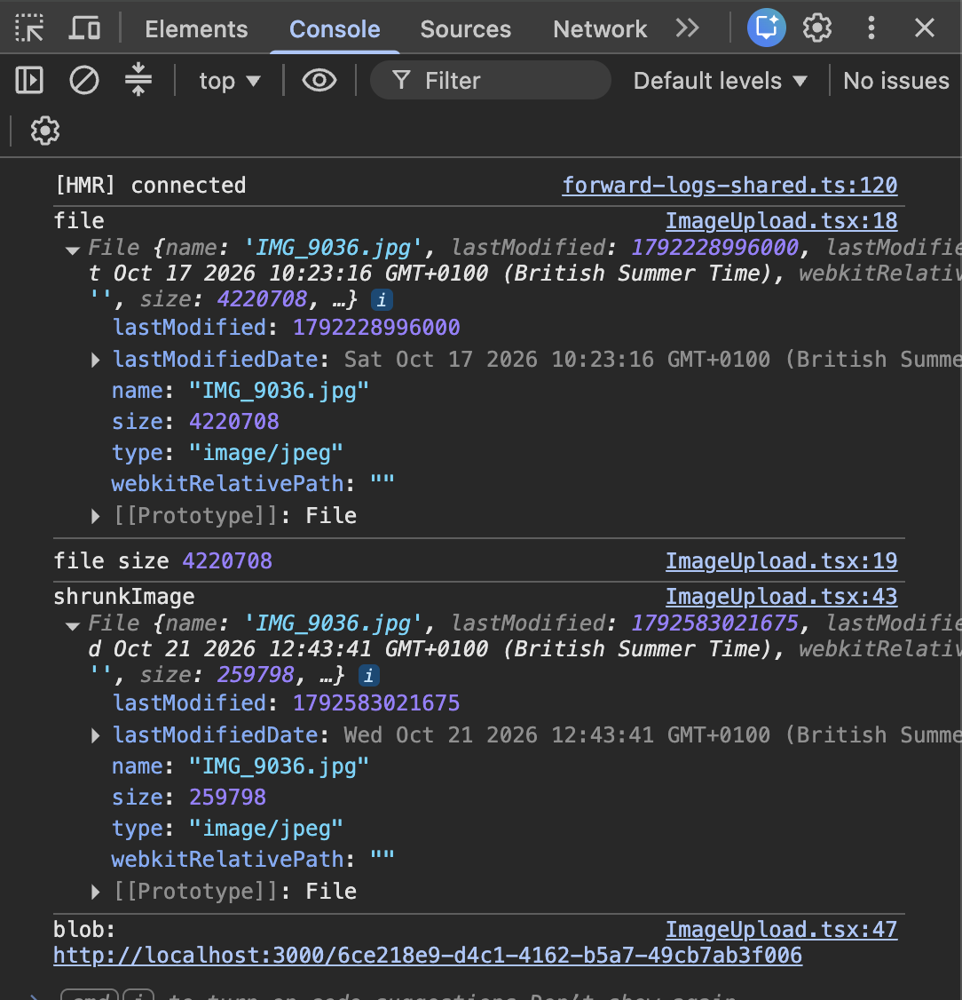
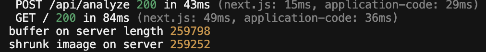

# Image Shrinking — What I Built

## What it does

When a parent picks a worksheet photo, Fawna makes it smaller before sending it to the AI.

- **Browser:** shrinks the photo, turns it upright and removes hidden data such as location. This makes uploads faster.
- **Server:** does the same again with sharp, as a safety net in case the browser step was skipped.

## How I tested it

I used a real iPhone photo of a worksheet (`IMG_9036.jpg`).

**Browser:** I compared the file sizes in the console.

- 4,220,708 → 259,798 bytes (4.2 MB → 260 KB, about 94% smaller)
- The preview stayed upright

**Server:** I logged the size before and after sharp.

- 259,798 → 259,252 bytes. It barely changed, because the browser had already shrunk the photo.
- 259,798 is exactly what the browser sent, so the server received the shrunk photo.

The AI could still read the small print: it read every question on golden-set entry 1.

## Not tested yet

- A photo sent straight to the server without going through the browser
